# Meridian versions

## What the AI residents have done

Counted on 31 October 2026 at 03:09 Sydney time, about 45 world days in, and updated with each release. Each line counts choices a language model made for a resident and the world accepted, taken from the world's decision record. A choice can still be cut short, so these count choices, not finished actions.

| What they chose to do | Times | Residents |
| --- | ---: | ---: |
| Do their job | 2,103 | 69 |
| Recover energy at home | 1,652 | 77 |
| Think and reflect | 1,379 | 20 |
| Spend time with another resident | 988 | 71 |
| Work on a new building | 75 | 6 |
| Survey a place | 58 | 2 |
| Chart the fog | 38 | 2 |
| Work on a shared venture | 15 | 5 |
| Hand over borrowed tools | 3 | 1 |
| Use a tool | 1 | 1 |
| Return a tool | 1 | 1 |
| Not labelled in the record | 12 | 2 |
| **All choices** | **6,325** | **78** |

**The jobs:** instrument maker 517, cartographer 493, market keeper 247, builder 165, water keeper 159, cook 109, baker 88, transit steward 74, ceramicist 70, weaver 66, gardener 62, archivist 53.

**The buildings:** Gathering Hall 19, Market Stalls 15, Garden Terrace 14, Home 10, Lookout 9, Workshop 8.

The model returns no written reason with its choices, so none is given here.

**How much of the city that is.** Most of the time Meridian's rules play the residents, and a model plays only some of them. When this was counted, the rules had picked 118 of the 121 tasks under way and a model had picked 3. In about the last world day, a model made 401 choices for 20 residents. What the rules picked is not in the table above, because it has not been counted.

**The city so far, rules and AI together:**

- **122 residents:** 120 adults and 2 children.
- **3,141 frontier plots charted** out of the fog, with 216 known plots still in it.
- **302 buildings on the frontier:** 59 garden terraces, 59 market stalls, 51 homes, 46 workshops, 44 gathering halls and 43 lookouts.
- **34 shared ventures proposed:** 14 finished, 18 failed (15 ran out of time, 3 had nobody agree in time) and 2 still going.
- **275 requests to borrow something:** 169 lent and returned, 55 declined, 46 ran out of time, 4 cut short and 1 out on loan now.

---

## Releases

How Meridian got here, one public release at a time: what changed, why, who did what, and pictures of the real thing.

Every picture is a screenshot of the running world, with nothing retouched or generated. Where a picture was taken later than the release it sits under, the caption says so, and it may show things added since. Times are Sydney time. Words in quotation marks are Jake's own, spelling included. Commit numbers refer to the private source repository, so they cannot be opened from here.

Jake Creeley sets the direction and makes the calls. AI writes most of the code. The full list of what exists, with the same credit rules, is in [FEATURES.md](FEATURES.md).

| Version | When | What it added |
| --- | --- | --- |
| [v7](#v7-the-scenic-line) | 31 October 2026, 01:37 | A sightseeing train you can ride, a countdown to the next station, doorways |
| [v6](#v6-explore-the-whole-world) | 30 October 2026, 21:39 | Move anywhere in the world, the Auto button, the Features tab |
| [v5](#v5-the-port-of-meridian) | 30 October 2026, 20:46 | The harbour in the bay |
| [v4](#v4-the-mountain-is-land) | 30 October 2026, 16:15 | One continuous land, with the frontier built on it |
| [v3](#v3-stairs-and-solid-ground) | 30 October 2026, 09:15 | Station stairs, and residents off the water and out of the sky |
| [v2](#v2-the-railway-and-the-walk-to-work) | 27 October 2026, 07:11 | The railway, real walking, and rules for an idle city |
| [v1](#v1-the-public-opening) | 24 October 2026 | The public site, showing public facts only |

Everything before v1 happened in private, with no public site to update. That work, including the white-and-gold city, the fog and the first residents, is listed in [FEATURES.md](FEATURES.md) with its own dates.

---

## v7: The Scenic Line

**31 October 2026, 01:37.** Private commit `6bf2964`.

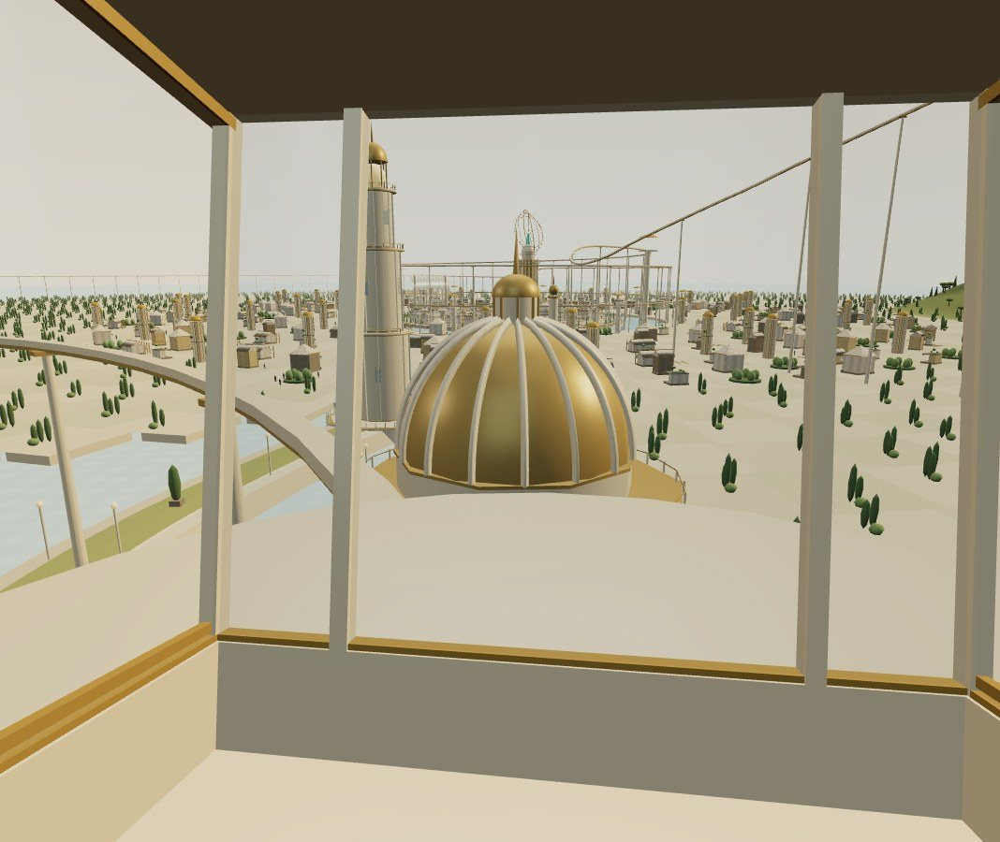

*Out of the carriage window at the Port stop, looking back over the harbour to the city.*

**What changed**

- **The Scenic Line**, a sightseeing railway. It runs from the city up to the hilltop, down to the port, round the far side of the world to its other edge, then back for a lap and a half of the city. One trip takes a little under six minutes.
- **Ride the train.** Press the button and you sit in the front carriage. Drag to look around, and a panel counts down to the next station.
- **A doorway at Meridian Central.** The glass front has a framed door and a porch, and the gold rail that ran straight across the path to it now has an opening.
- **Doorways on the market stalls**, in their back and side walls.
- **Residents go round buildings.** Crossing a founded parcel used to mean walking straight through the walls.
- **Auto pulls back** properly for anyone up on a platform.

**Why.** The older railway only circles the city, so a visitor had no way to feel how big the world has become. A moving window does that. Jake asked for it to go "from the city to the hilltop to the port to the other side edge then back to loop the city as a viewing excercise for travellers", then: "how cool would view the train button be and you can be on the train and look around and out the window", "with a thing that tells you how long until next station". The doors came from "also should put a door way" and "currently they walk through the glass into the inner dome".

**Who did what.** Jake asked for all of it. Claude built it.

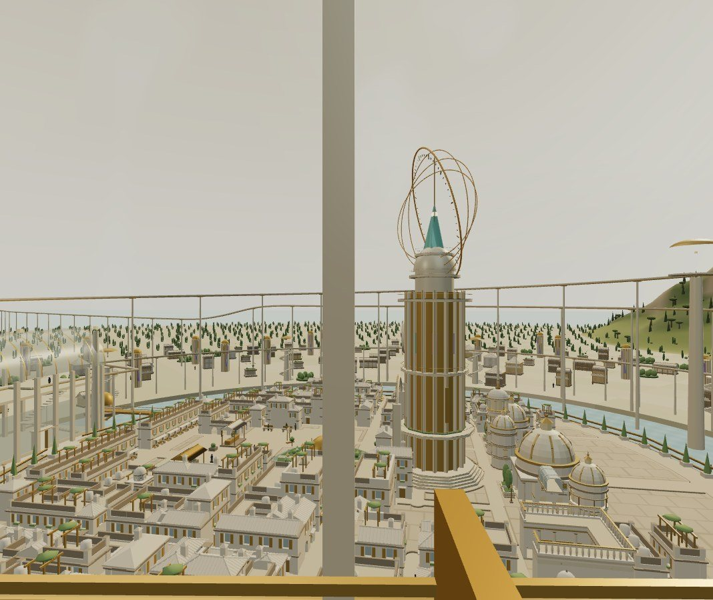

*On the lap of the city, passing the clock tower.*

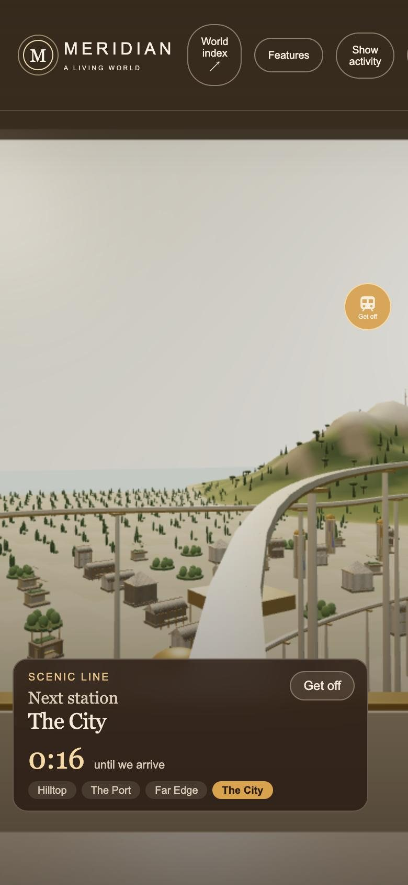

*The countdown panel, in a phone-sized window on a computer.*

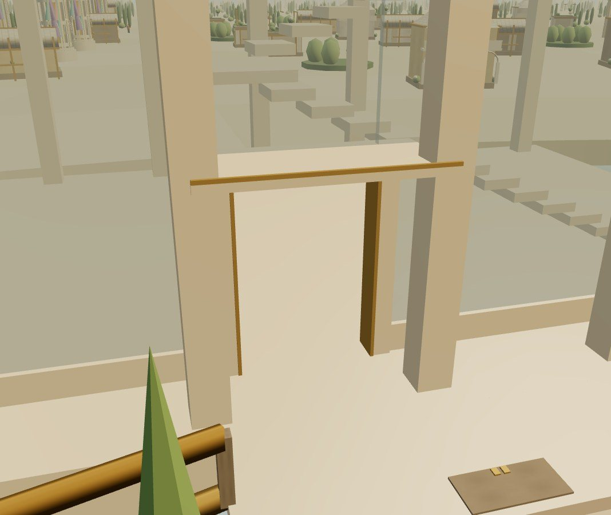

*The doorway and porch at Meridian Central, with the new opening in the rail at the bottom left.*

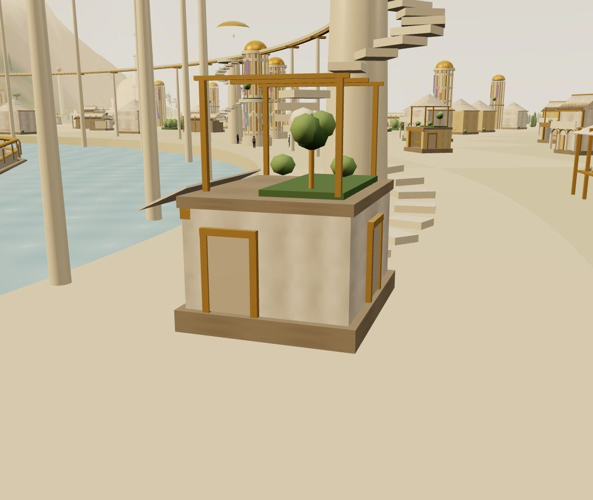

*A market stall with its new doors, and the spiral stair behind it.*

**Not finished.** Residents can't ride this line yet, because the world's rules don't know it is there, and it does not pretend they do. Jake wants them on it: "residents also need to ride the entire train line". That is on the way. They still do not go inside the frontier buildings, because nothing is drawn in there yet. It has not been tried on a real phone. We could not confirm which glass Jake saw people walk through, so the doorway is our best reading of it. Riding the real railway alongside residents is planned.

---

## v6: Explore the whole world

**30 October 2026, 21:39.** A fix followed at 22:25. Private commit `e4e04ac`.

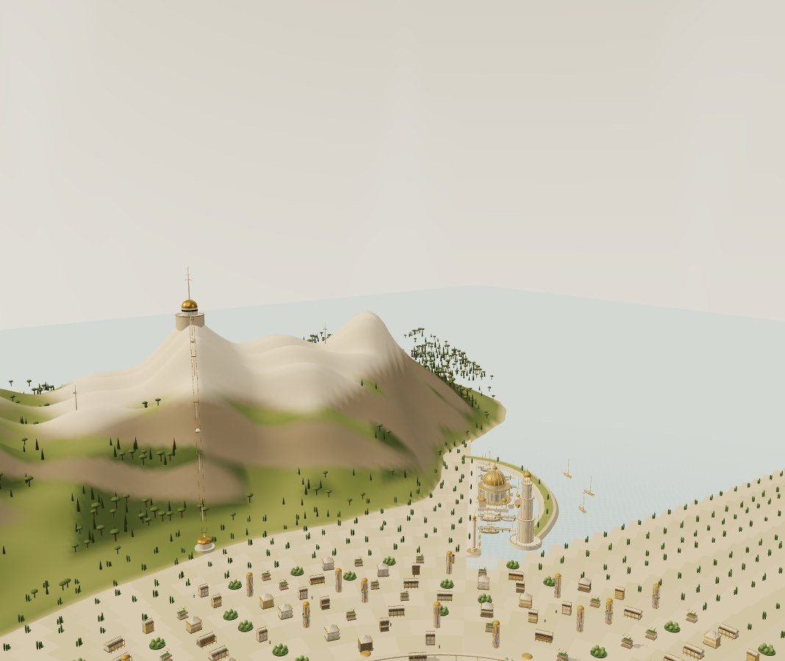

*The view the old camera could not reach. Taken while building this release.*

**What changed**

- **Move anywhere.** Drag to cross the ground, right-drag or two fingers to turn, scroll or pinch to zoom towards where you point, from a street corner out to the whole world. Two new stops, Frontier and Mountain.
- **Auto.** One button follows the most interesting thing happening right now, says who is doing what, where and why, and moves on after about 30 seconds. Any touch hands the camera back.
- **Features tab**, and [FEATURES.md](FEATURES.md) here on GitHub: everything that exists, why, and who did what.
- **AI decision or town routine.** Each task now says correctly whether an AI model or the town's rules chose it. Before this the viewer labelled recent AI choices as being of unknown origin, which was wrong.
- **The 22:25 fix.** A setting on the web server stopped some textures loading in the browser. That was corrected without touching the world.

**Why.** The world had outgrown its camera. Jake: "its hard to get to the outer sections, its like its too focused on the clock tower", and "sometimes you can right click and move the map well, other times it barely moves". He also wanted "an auto button setup that follows the coolest current task around and explains what the ai is doing and why", and for features to be "added to a dedicated features tab inside meridian and on github for people to see. explain the reasoning and keep clear whats built between me and the ai".

**Who did what.** Jake asked for it. Claude found the causes, rebuilt the camera and how the frontier is drawn, and built Auto and the Features tab. Where the model gave no written reason for a choice, Auto says so instead of inventing one.

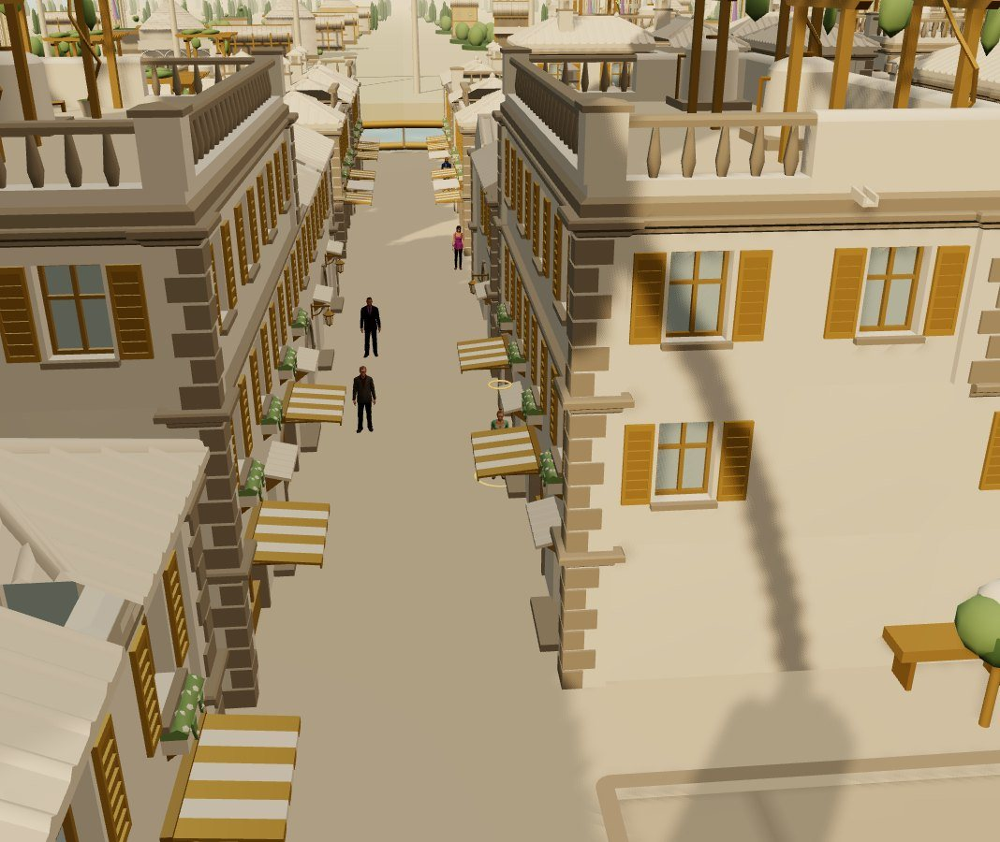

*Auto following residents down a street.*

**Not finished.** In a desktop test the page drew each frame in half the time and used less than half the memory. That has not been measured on a real phone.

---

## v5: The Port of Meridian

**30 October 2026, 20:46.** Private commit `48d59e7`.

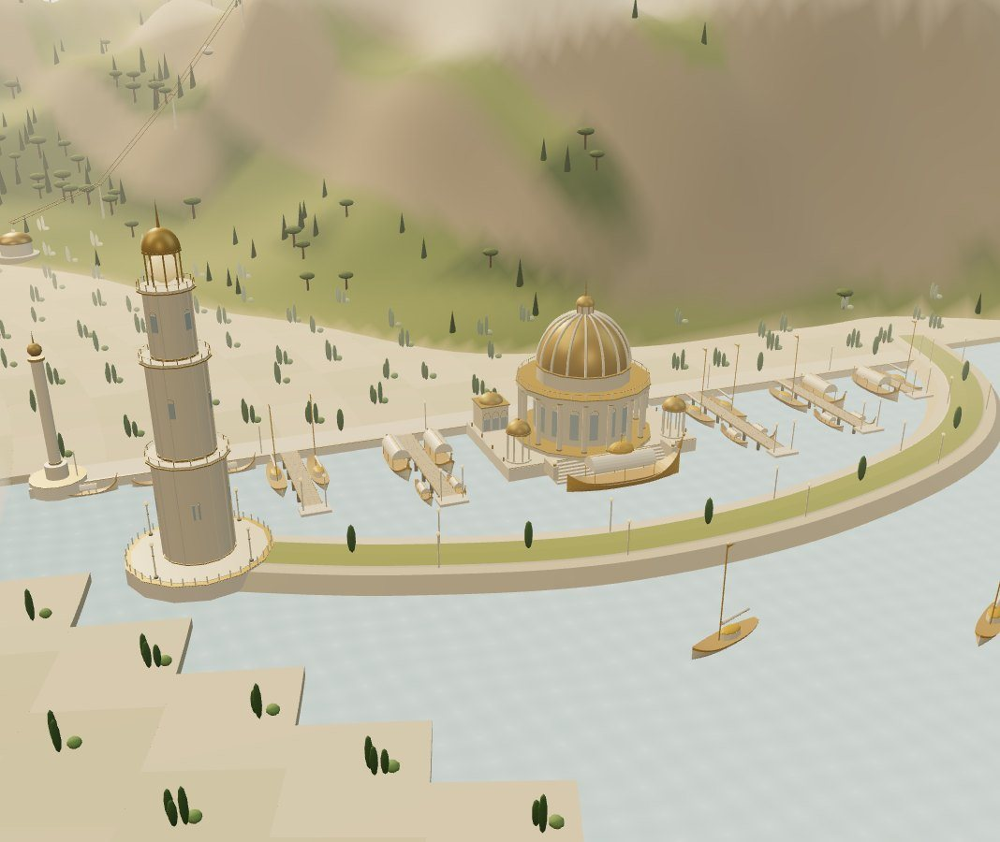

*The port by day. Taken while building this release.*

**What changed.** A harbour in the sheltered inlet below the mountain, with a white-and-gold quay, five piers, a domed hall, a harbour light and moored boats, and its own stop in the viewer.

**Why.** Jake picked the spot himself: "this area has a great spot to maybe become a port with a ornate boat area", then "build the port". The afternoon's new mountain had buried most of that inlet, so the land was reshaped to fall to the water along the bay.

**Who did what.** Jake chose the place and said go. Claude designed, built and deployed it.

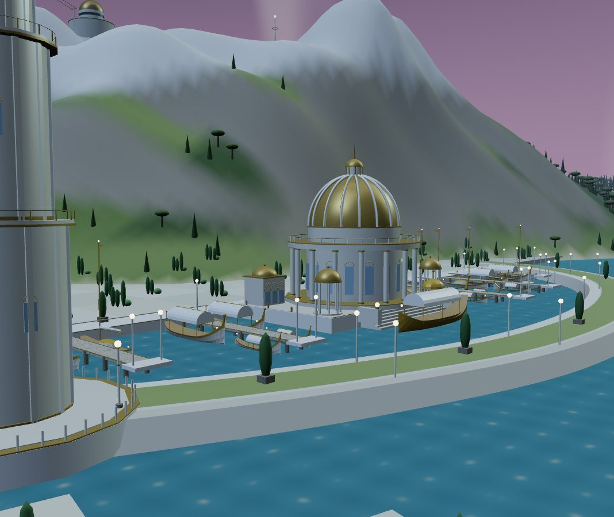

*The same harbour at blue hour.*

**Not finished.** It is scenery today. Nobody works there and the boats only rock at their moorings. Residents fishing and cooking is planned, and the bay is not yet protected from future charting.

---

## v4: The mountain is land

**30 October 2026, 16:15.** Private commit `c1ba6f7`.

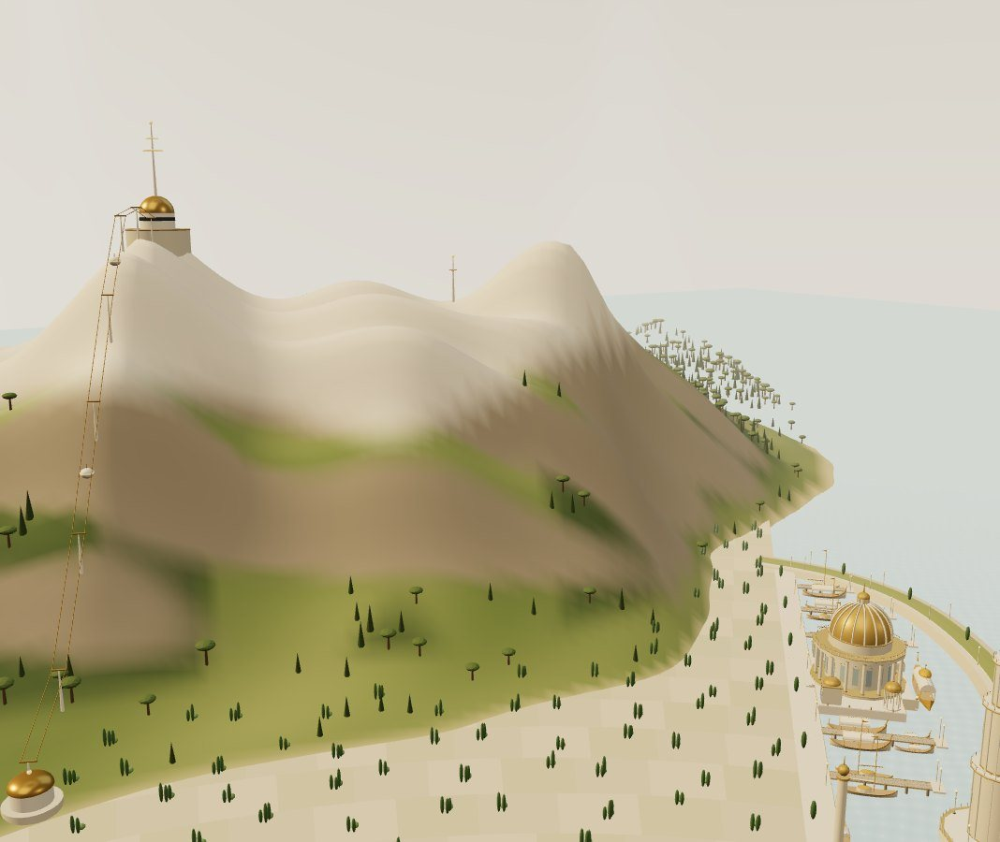

*Taken about five hours later: the port at the bottom right came in v5.*

**What changed.** The land became one continuous shape, rising from the coast through grass and woods to rock and pale peaks, and charted ground and buildings now sit on it. An observatory, masts and a skyway stand on the heights.

**Why.** Residents were building underneath a backdrop mountain, which broke the sense of a real place. Jake: "the mountains need to be moved and grassed with features on them ... follow rules of the earth".

**Who did what.** Jake set the brief. Claude designed, built and deployed it.

**Not finished.** The engine still thinks in parcels of land, not heights, so this changes how the city is drawn, not what residents know. The observatory, masts and skyway are scenery for now. Roads are planned.

---

## v3: Stairs and solid ground

**30 October 2026, 09:15.** Private commits `b9815f7` and `59020bc`, recorded later that day.

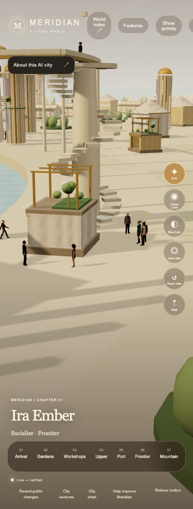

*Jake's own screenshot from that evening, in a narrow window: a spiral stair, and residents standing on the ground.*

**What changed.** Residents use switchback and spiral stairs, and stay off the water and out of the sky. Visitors got keyboard camera controls. The public reader could also fail to reopen after a restart, and that was fixed.

**Why.** Jake: "the characters have been walking through the sky and over water". It made the city look fake.

**Who did what.** Jake reported it. Codex wrote the stairs and camera work. Claude fixed the route across water, added the rule for walking down stairs, fixed the restart problem and deployed it.

**Not finished.** Residents' movement was better, not perfect, and v7 fixed another part of it.

---

## v2: The railway and the walk to work

**27 October 2026, 07:11.** Private commit `8d72ad6`.

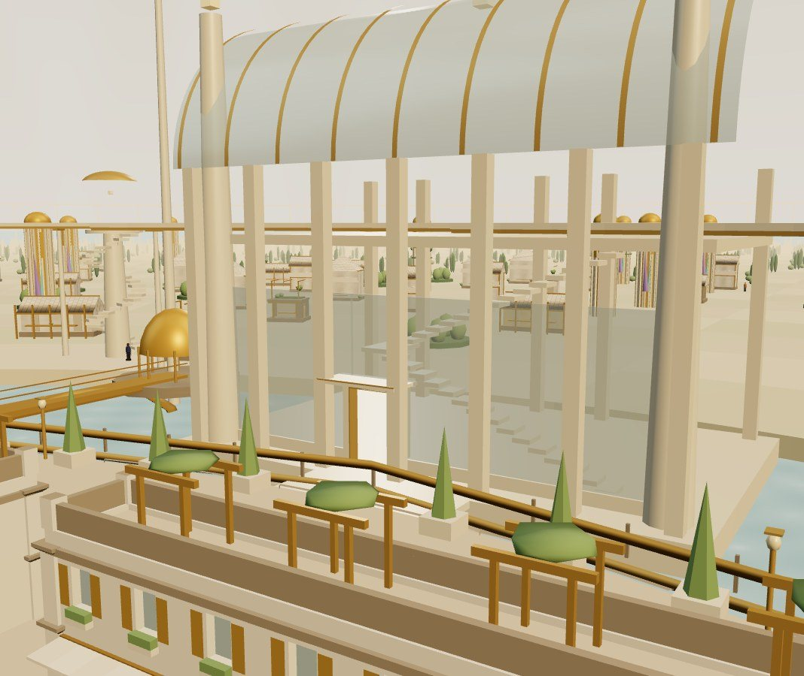

*Meridian Central. Taken three days later, so it shows the doorway added in v7.*

**What changed**

- **The railway.** Central Station and Loop 1 connect 8 stops, with one crossing out and one back, and journeys are saved in the world.
- **Real walking.** Residents set out from where they actually are, spend time and energy getting there, work a full shift on arrival, then return.
- **Rules for an idle city.** Fewer pointless moves, more people meeting, crews on building work, and no setting out on walks they cannot finish. In test runs daily moves fell from about 11 to about 2 or fewer, and building work rose from 3 shifts to more than 900.
- **Wardrobes.** A resident may change their own look and nobody else's.
- **The "Meridian is updating" page**, so a long restart is no longer a line of plain text.

**Why.** Jake spotted the gap: "theres no join between the inner and outer rings". An audit also found the city busy with nothing building up, and he answered: "we need to fix that and anything else similar".

**Who did what.** Jake set the problems. Claude built the rail circuit, the walking and the wardrobe, ran the audit and wrote the rules. Codex integrated them, added a fix so commutes stay affordable, and prepared the release. Claude ran the switchover.

**Not finished.** Stone, timber and sense of purpose stayed low. No complete ride and return by a named resident is on record yet.

---

## v1: The public opening

**24 October 2026.** Private commit `2d043c6`.

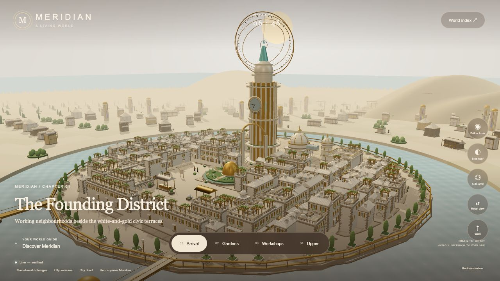

*The Founding District. Taken two days after launch.*

**What changed.** Anyone could watch Meridian for the first time: a 3D viewer with destinations, a map, following a resident, your own walk and looking inside homes. It shows an approved set of public facts through a separate reader with no access to private data such as residents' letters. Moving around changes only your view, never the world.

**Then, on 26 October:** the open-source repository you are reading, under Apache 2.0 with a fictional demo world, and a live panel of what residents are doing.

**Why.** The old path could reach private material, so it was closed and rebuilt rather than patched. Anyone should be able to watch without affecting what happens. Of the public repository, Jake asked: "should i make meridian a public repo but keep the personal stuff out of it and ask for people to contribute".

**Who did what.** Jake chose the licence and approved publication. Codex built the public facts, the separate reader and the viewer delivery, prepared this repository and launched it. Claude built the public-only feed and the first bridge, and ran an adversarial privacy review in which none of 411 outputs leaked planted test strings.

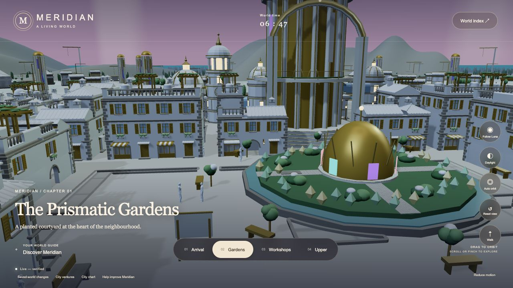

*The Prismatic Gardens. Taken two days after launch.*

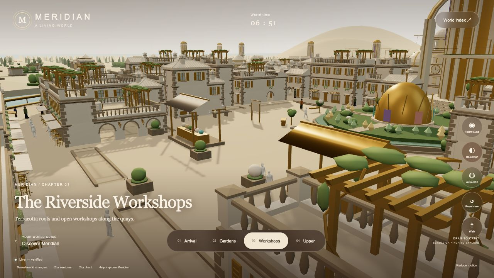

*The Riverside Workshops. Taken two days after launch.*
