# Meridian versions

## What the AI residents have done

Counted on 2 November 2026 at about 22:40 Sydney time, 48 world days in, and updated with each release. Each line counts choices a language model made for a resident and the world accepted, taken from the world's decision record. A choice can still be cut short, so these count choices, not finished actions.

| What they chose to do | Times | Residents |
| --- | ---: | ---: |
| Do their job | 2,717 | 117 |
| Think and reflect | 2,362 | 119 |
| Recover energy at home | 1,735 | 100 |
| Spend time with another resident | 988 | 71 |
| Survey a place | 102 | 10 |
| Work on a new building | 84 | 11 |
| Chart the fog | 84 | 10 |
| Work on a shared venture | 15 | 5 |
| Use a tool | 14 | 2 |
| Hand over borrowed tools | 3 | 1 |
| Return a tool | 1 | 1 |
| Not labelled in the record | 12 | 2 |
| **All choices** | **8,117** | **120** |

**The jobs:** instrument maker 584, cartographer 496, market keeper 317, builder 236, water keeper 221, cook 162, transit steward 125, baker 124, weaver 123, ceramicist 117, archivist 111, gardener 101.

**The buildings:** Gathering Hall 19, Market Stalls 18, Garden Terrace 16, Workshop 11, Home 11, Lookout 9.

The model returns no written reason with its choices, so none is given here.

**How much of the city that is.** Most of the time Meridian's rules play the residents, and a model plays only some of them. When this was counted, the rules had picked 107 of the 114 tasks under way and a model had picked 7. In about the last world day, a model made 497 choices for 120 residents: since v8 it takes all 120 adults in turn, about one every minute and a half. Of its 1,737 choices since v8, none was to spend time with another resident or to ride the Scenic Line, so the 988 in the table are all from before v8. The drop began earlier than v8, on 27 October, when the world changed how it puts the choice to the model: time with others fell from about a third of its choices to 2 of about 3,800. In a side test on a frozen copy of the public facts, the same model given a plainer description of residents' lives chose time with others 12 times in 60 and the ride once. That wording went live in v11 on 6 November, and its numbers haven't been counted yet. The model gives no reason with its choices, so this describes what changed, not why it chose. What the rules picked is not in the table above, because it has not been counted.

**The city so far, rules and AI together:**

- **122 residents:** 120 adults and 2 children.
- **3,141 frontier plots charted** out of the fog, with 216 known plots still in it.
- **344 buildings on the frontier:** 71 garden terraces, 70 market stalls, 60 homes, 56 workshops, 44 gathering halls and 43 lookouts.
- **The last 32 shared ventures to end,** which is as many as the world keeps: 10 finished, 22 failed (13 ran out of time, 9 had nobody agree in time). 2 more are going now. Earlier versions of this page called this the total proposed, which was wrong.
- **275 requests to borrow something:** 169 lent and returned, 55 declined, 46 ran out of time, 4 cut short and 1 out on loan now.

---

## Releases

How Meridian got here, one public release at a time: what changed, why, who did what, and pictures of the real thing.

Every picture is a screenshot of the running world, with nothing retouched or generated. Where a picture was taken later than the release it sits under, the caption says so, and it may show things added since. Times are Sydney time. Words in quotation marks are Jake's own, spelling included. Commit numbers refer to the private source repository, so they cannot be opened from here.

Jake Creeley sets the direction and makes the calls. AI writes most of the code. The full list of what exists, with the same credit rules, is in [FEATURES.md](FEATURES.md).

| Version | When | What it added |
| --- | --- | --- |
| [v12](#v12-bodies-sooner-and-riders-in-their-seats) | 7 November 2026, 08:45 | Residents' bodies appear in about a third of the time, and Scenic Line riders sit in the seats |
| [v11](#v11-home-to-bed-bodies-that-move-and-lunas-workbench) | 6 November 2026, 17:57 and 19:28 | Residents rest indoors and lie on the bed, bodies move with their task, trips are named, a plainer question to the AI, Luna's workbench |
| [v10](#v10-nobody-in-the-sky-nothing-through-the-rail-and-the-night-button-back) | 2 November 2026, 23:02 | Riders no longer walk through the air, the rail clears the lookouts, the night button is back |
| [v9](#v9-restarts-in-minutes-and-a-new-home-page) | 2 November 2026, 19:54 | Restarts in minutes instead of hours, and a new home page |
| [v8](#v8-lunas-seat-and-a-city-whose-rules-can-change) | 31 October 2026, 20:41 | Luna's seat, City rules, residents on the Scenic Line, model turns for every adult, public pages and analytics |
| [v7](#v7-the-scenic-line) | 31 October 2026, 01:37 | A sightseeing train you can ride, a countdown to the next station, doorways |
| [v6](#v6-explore-the-whole-world) | 30 October 2026, 21:39 | Move anywhere in the world, the Auto button, the Features tab |
| [v5](#v5-the-port-of-meridian) | 30 October 2026, 20:46 | The harbour in the bay |
| [v4](#v4-the-mountain-is-land) | 30 October 2026, 16:15 | One continuous land, with the frontier built on it |
| [v3](#v3-stairs-and-solid-ground) | 30 October 2026, 09:15 | Station stairs, and residents off the water and out of the sky |
| [v2](#v2-the-railway-and-the-walk-to-work) | 27 October 2026, 07:11 | The railway, real walking, and rules for an idle city |
| [v1](#v1-the-public-opening) | 24 October 2026 | The public site, showing public facts only |

Everything before v1 happened in private, with no public site to update. That work, including the white-and-gold city, the fog and the first residents, is listed in [FEATURES.md](FEATURES.md) with its own dates.

---

## v12: Bodies sooner, and riders in their seats

**7 November 2026, 08:45.** The site moved to private commit `a107106`. The engine didn't change.

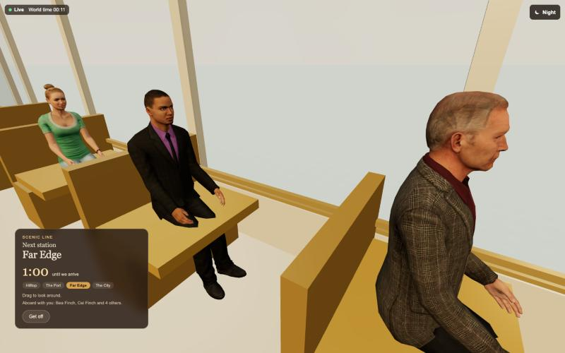

*Inside the Scenic Line with v12, looking back from the front of the carriage. Taken before the release, on 7 November at about 03:40, in a browser on Claude's machine. The ride comes from a test world the real engine ran, not from the live city.*

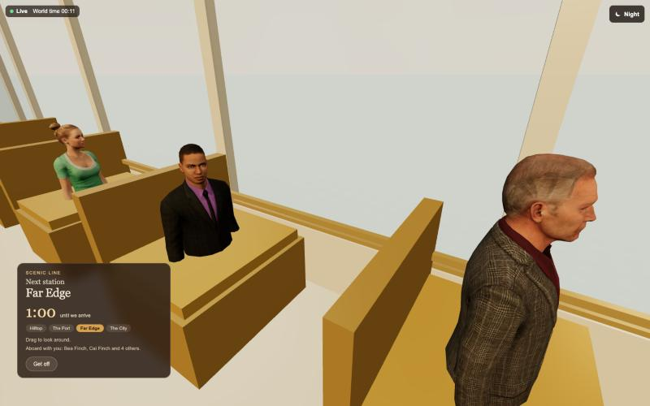

*The same ride and view with v11, the build that was live, for comparison. Taken on Claude's machine at about 03:43, before the release.*

**What changed**

- **Bodies appear sooner.** A resident's body used to take over a minute to appear after the page opened, and about as long on a return visit. The body files are now about half the size (49 MB down to 22 MB on a first visit with every body), the ones on screen load first, loading starts as soon as the page does, and the files are kept by the browser for a year, so a returning visitor downloads about 4 MB instead of 49 MB. The movements are stored a little less exactly (each file is checked to be under a twentieth of a degree out at every joint) and the skin pictures in a smaller format.
- **Riders sit in the seats.** Residents riding the Scenic Line used to be drawn standing, with their feet about 25 cm below the carriage floor and their legs inside the seats. They now sit on the cushion with their knees bent, shins down to the floor and hands on their laps, for short and tall residents alike, and on the steepest climbs and descents. The seats are set back underneath, so the shins show in front of them.

**Why.** Jake approved the work with "approve all" and the release with "and ship 12 in the meantime". Both were found watching the live city: bodies were slow enough that visitors saw stand-in figures for the first minute, and riders looked like they were standing in the floor.

**How it was checked.** The load times were measured before and after on the same slow test machine, which draws in software at about one frame a second, so the real times on a phone or computer should be shorter than these, though nobody has checked on one yet. With every body:

| | First body | All bodies | Body files downloaded |
| --- | ---: | ---: | ---: |
| v11, first visit | 76 s | 81 s | 49 MB |
| v12, first visit | 23 s | 48 s | 22 MB |
| v11, returning | 79 s | 79 s | 49 MB |
| v12, returning | 19 s | 39 s | 4 MB |

With the lighter mode, the first body came in 21 seconds instead of 58. The seating was checked by replaying a whole ride from the real engine, six riders over 18 world minutes, frame by frame: in all 41,286 rider frames each rider sat on a drawn cushion in the right carriage, feet on the floor and inside the walls. The same replay with v11 had every rider's feet 24 to 26 cm below the floor. The public file audit passed for all 113 files, including the 34 smaller body files. The site was closed for about 2 minutes 13 seconds while the new viewer did its first full check, with the city engine paused for 65 seconds of that. After it reopened, the server's own check loaded the page, a picture, the rules and the Scenic Line from inside, and a body file came back from outside with its one-year cache.

**Still not right.**
- The city model itself (3.9 MB) is still downloaded again on every visit, because its name doesn't change when it does.
- The bodies have no sitting movement in the library they come from, so sitting is made by bending a standing body's joints. Seated riders don't move their arms or look around.
- The smaller body files haven't been compared side by side with the old ones up close.
- The live feed still goes stale more often than before 6 November (see v11). v12 doesn't change that.

**Who did what.** Jake approved the work and said when to ship it. Claude found both causes, built the smaller body files, the loading order and the seating, measured before and after, wrote the deploy kit and ran the deploy.

---

## v11: Home to bed, bodies that move, and Luna's workbench

**6 November 2026, 17:57 and 19:28.** Two changes on one evening. At 17:57 the engine moved to private commit `8fed9e5`, which carries the new question to the AI from `e7e6e33`. At 19:28 the site moved to `f046af4`.

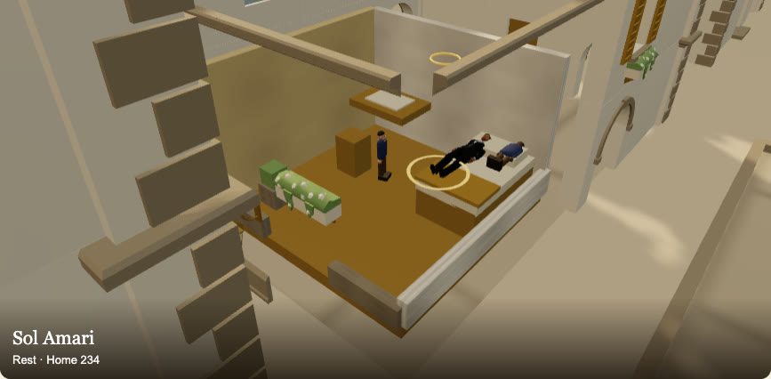

*Inside Home 234 on the public site, opened from Sol Amari's panel. Taken at 19:52, about 25 minutes after the release, in a browser on Claude's machine, and cropped to the room.*

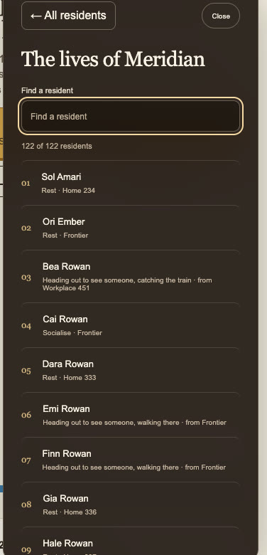

*The residents list on the public site at 19:36, cropped to the list.*

**What changed**

- **Residents go inside to rest.** A resident at home is now inside the house, not standing at the door. Open a home's view and the residents resting there lie on the bed. Two fit, so partners take turns and anyone else stands. There's no lying-down movement in the library the bodies come from, so a lying resident is the standing body laid flat.
- **Bodies move with what they're doing.** Adults now play movements chosen by their task: working at a bench, going through papers, writing notes, talking, listening, waiting, stretching, looking around and more. These come from Microsoft's Rocketbox avatar library (MIT licence). They were prepared on 18 October and are shown here for the first time. Children keep their own movements.
- **Tasks say when someone is on the way.** A task's minutes include the trip to it, so a resident walking to the station on the way home used to read "Rest". The panels, the list and Auto now say "Heading home to rest, catching the train", "on the train" or "walking from the station".
- **A plainer question to the AI.** Since 27 October each resident's turn had sent the model bare action codes, and its choices to spend time with another resident fell to 2 in about 3,800 (see the count at the top of this page). The turn now says what each choice means. On a frozen copy of the public facts, 30 residents chose think 15, work 13 and build 2 under the old wording, and build 12, rest 11, time with others 4, work 2 and the train ride 1 under the new one. What the live city chooses with it hasn't been counted yet.
- **Luna's workbench.** Luna can now write small programs in a sealed workshop. Only she is offered it, on her own turns. Each run is sealed off from the city and limited to six seconds, and its model calls come out of the same daily spend cap as every other AI turn. If the workshop isn't ready, she simply isn't offered it and the city carries on.

**Why.** Jake, watching the live city: "i just checked the world, there is characters at stations that there tasks view says they are at home resting", and later "i think we should make them able to go inside their houses to go home, resting implies them at the house, horizontal ability in there bed. they should be able to interact freely in the world rather than rules, move more freely with less robotic movement". The new question to the AI answers the drop in time together that the count above found. The workbench is the first step towards residents who build with code, not only with stone.

**How it was checked.** Before the engine changed, the new engine re-proved the city's whole recorded history. The site was closed for 12 minutes 48 seconds while it switched. For the site, the public file audit passed for all 79 files, including the two movement libraries. The site was closed for 5 minutes 15 seconds and the engine paused for 3 minutes 2 seconds. Afterwards the site served the new build, both movement libraries loaded, and the deploy's own check passed.

**Still not right.**
- **Since the 17:57 engine change, the live feed keeps going stale.** It happens about 30 times an hour, against 1 to 5 an hour before. Each time, the page shows "Last recorded" and Offline, and the clock stops until it reconnects, for up to about a minute and a half. The cause, found the same evening: about every 4 minutes the engine pauses for 10 to 29 seconds after saving a minute, longer than the 15 seconds the feed waits. It isn't fixed yet.
- Nobody sits, eats, rows or carries yet: the library has no such movements. Fishing trips and family meals are being built and checked on a separate branch, not live.
- The home page's "resting" count still includes residents on their way home.
- Nobody has yet checked one of Luna's real workbench turns on the live city.
- The AI count at the top of this page is still from 2 November.

**Who did what.** Jake asked for the indoor rest and the trip wording after watching the live city, and ran the commands that switched the engine and deployed the site. Claude built the viewer changes, the new question to the AI and the workbench, ran the proofs and wrote the deploy kits.

---

## v10: Nobody in the sky, nothing through the rail, and the night button back

**2 November 2026, 23:02.** Private commit `8cc4208`, for the site only. The engine and the world did not change.

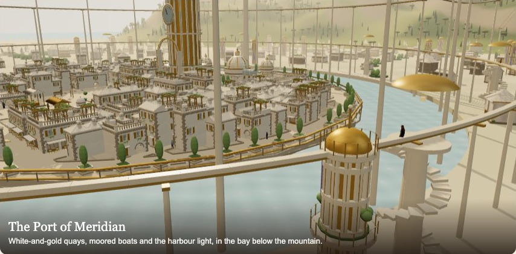

*Before: the little train's rail runs through a lookout's dome. Taken at 21:31 from a build on Claude's machine showing the live city's public facts, with the camera aimed at the lookout by hand.*

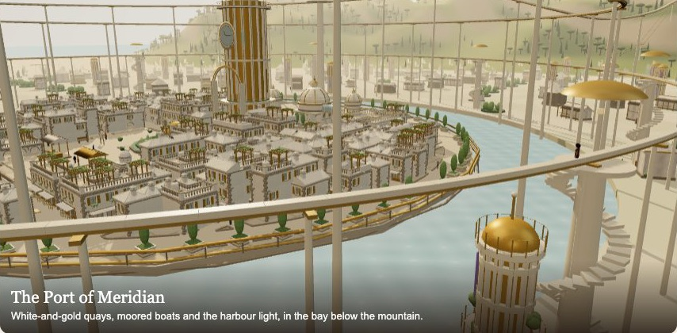

*After: the rail passes over the same lookout. Taken at 21:42 the same way, before the night button went back.*

**What changed**

- **Riders stay on the train until it stops.** The world says which stop a train has reached, and the drawn train gets there a moment later. Riders were let off as soon as the world's minute turned, then walked to the top of the stairs in a straight line at rail height. Replaying the live feed through the old code, 13 riders did that in 6.5 minutes, the longest for 15 seconds and 42 units. They now ride in with the train and step off once it has stopped. If it never pulls in, they appear at the top of the stairs instead. No long walk can start from off the ground any more, whatever the reason.
- **The rail clears the lookouts.** The little train's rail ran at height 9, straight over the middle of the first ring's plots, and the two lookouts there reach 11. The residents didn't build into it: the lookouts went up around world minute 15,000 and the rail arrived at minute 56,069, so it was wrong from the day it opened. It now runs at 12, and the station stairs and Meridian Central's vault and towers went up with it.
- **The night button is back.** v9 moved day and night into the View menu, and nothing showed that View opened. That was Claude's mistake. It now sits on the city window beside Fullscreen and stays there at full size. View has an arrow now too.

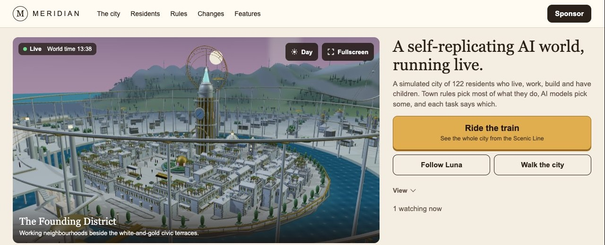

*The public site after pressing Night, in a fresh browser. Taken at 23:04.*

**Why.** Jake was watching the live city: "they also started floating again today and built through the railway line". While the fix was being built: "theres still a house through the railway lol", "and just saw a character walking through the sky" and "the night time button has vanished too".

**How it was checked.** Two replays of the live feed went through the real walking code, frame by frame, with the real train movement: 64 snapshots, 38,400 frames, 32 minutes of real time. Nobody crossed open air. All they flagged were 15 riders taking a one-second step from the train down onto Meridian Central's platform deck, which is solid floor. For the rail, 18,191 drawn building parts and 632,013 triangles of the city model were tested against every line. On the old rail exactly two buildings met it, those two lookouts. On the new one nothing meets any line. The site was closed for 2 minutes 29 seconds and the engine paused for 1 minute 19 seconds, and the files on the public site match the build byte for byte. The replays test the code against real data. Nobody has yet sat and watched hours of rides on the public site.

**Still not right.** The little train stands still between minutes, then darts to the next stop in about 2 seconds. Six plots that nobody has built on, from ring 18 outward, are close enough to the Scenic Line's stop towers that a building there could hit one. Building has only reached ring 9.

**Who did what.** Jake spotted all three on the live site and ran the deploy command. Claude found the causes, built the fixes and measured them.

---

## v9: Restarts in minutes, and a new home page

**2 November 2026, 19:54.** Private commits `ac78ea1` for the engine and `f604476` for the site.

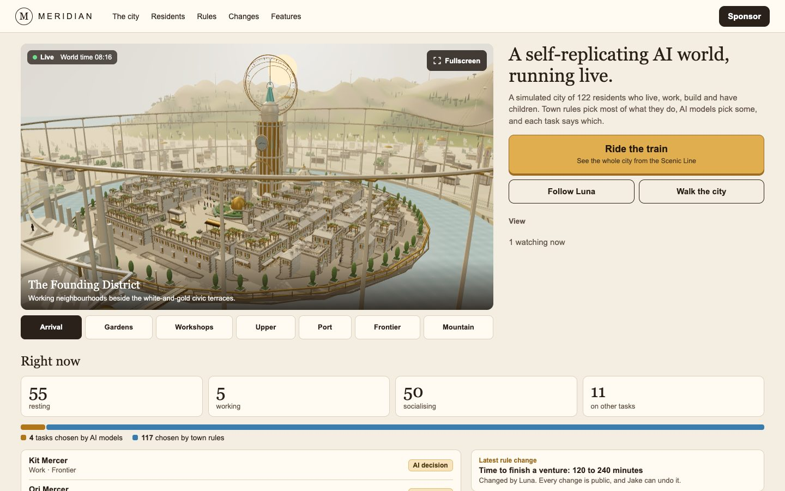

*The new home page on a computer, in a fresh browser. Taken at 20:00.*

**What changed**

- **Restarts in minutes.** The engine used to check its whole saved history again before it opened: 11 hours 35 minutes on 31 October, an estimated 17 hours by this release, and about 3 hours more each day. It now saves a proof of what it has already checked, opens from the newest one and checks only what came after. The first restart this way closed the city for 10 minutes, from 19:14 to 19:24, and the engine itself opened in 2 minutes. The closure on 31 October was 15 hours 14 minutes.
- **A new home page.** The city now sits in a window beside a plain statement of what Meridian is, with a Fullscreen button for the whole view. Ride the train is the main button, with Follow Luna and Walk the city beside it, and the places are in a row under the window. Riding, walking, Auto and the resident panel all still work. Putting it up closed the city for under 2 minutes, from 19:52 to 19:54.
- **Right now.** Under the window, the page counts what residents are doing, how many current tasks AI models chose and how many town rules chose, the latest rule change and how recent ventures ended. It is all counted from the public facts the page already holds, and the proportions stay in view.
- **Places and sponsorship.** Seven real pictures take you to each place. A plain line at the bottom says Meridian has no sponsor yet, what a sponsor pays for and that it buys no say in the city.
- **One load on a first visit.** A first visit in a clean browser loaded the page twice, throwing away the city it had started loading. It now loads once. Returning visitors get one reload the first time they come back.

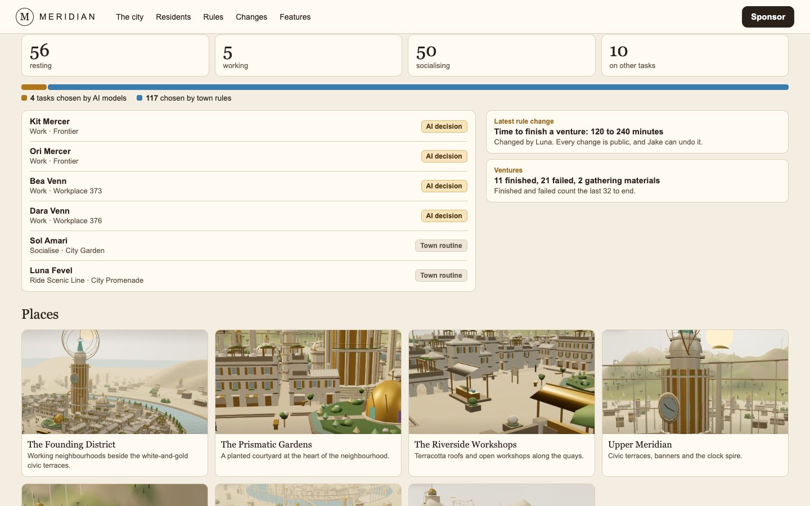

*The Right now section, taken at 20:02. The numbers change from minute to minute.*

**Why.** On the page, Jake said: "smaller world view with easier to view secitons perhaps with option for fullscreen , buttons that stand out more with importantce. its messy at the moment i feel". On the closure: "what do we do to fix that ridiculous downtime error today". A city that takes most of a day to come back can't be updated often or recover quickly from a crash.

**How the quick way was checked.** On a copy of the real city, opening through a proof reached the same state as the long way, and five kinds of damage to a proof each sent it back to the long way. So the check has moved rather than gone. A new proof is saved each world hour, and the saved history is checked against the newest proof every day, starting tonight. If a check fails, Jake gets a mail and the next restart takes the long way. Only a test of that mail has been sent, because no check has failed.

**Who did what.** Jake asked for both, chose this layout from Claude's mock-ups and said when to close the site. Claude built and measured them and ran the restart. Jake ran the last two install commands himself.

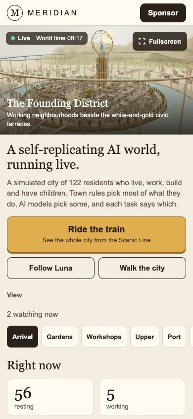

*The same page in a phone-sized window on a computer. Taken at 20:01.*

**Not finished.** A full re-check of old history from the start is not on a schedule yet: it takes over 21 hours, and running it beside the hourly proofs has not been measured. A crash with no good proof to open from is still the long way. A new version of the engine needs its own full proof first, over 21 hours in the background, though no closure for that. The 2 minute open had a proof only moments old, and an open late in the hour has not been timed on the live city. If the hourly proofs stop being made, nothing tells Jake yet, and the next restart would just be slower. On the new page, the View menu looks like a plain label. The Features tab on the site still shows the old entry for restarts until the next site release; [FEATURES.md](FEATURES.md) has the new one. Ventures are still failing, 21 of the last 32 to end.

---

## v8: Luna's seat, and a city whose rules can change

**31 October 2026, 20:41.** Private commit `ee2c665`.

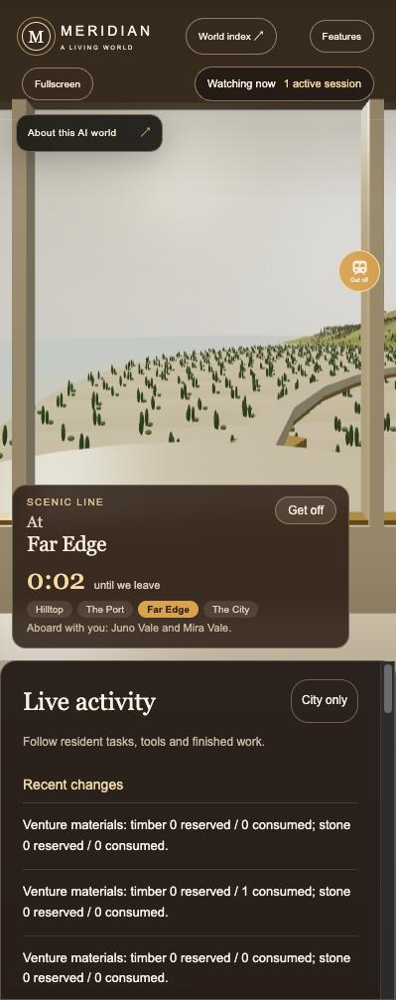

*On the Scenic Line at Far Edge, in a phone-sized window on a computer. The panel names who is on the train with you, here two residents, Juno Vale and Mira Vale. Taken at 20:57.*

**What changed**

- **Luna's seat.** Jake can talk to Luna and ask her to do things in Meridian. She reads the real city, changes rules within their limits, and keeps a file of her own between conversations. She acts only when he talks to her. What she changes in the city is public. The conversations and her file are not.
- **City rules.** A short list of the city's rules can now change while it runs, such as how long a shared venture has to finish. A change is a typed entry in the world's record, takes effect from the next minute and shows under City rules on the site. Jake can undo any change or stop her, with no model involved.
- **Residents ride the Scenic Line.** A resident can now go once round the whole line, whether the rules or a model picked it. If you are on the train, the panel says who is aboard.
- **Model turns for every adult.** The model used to choose only for a fixed group of 20 residents. It now takes all 120 adults in turn, about one every minute and a half, under a hard daily spending limit.
- **Public pages and search.** Ten plain pages say what Meridian is and is not, so people searching for a self-replicating AI world or an AGI experiment can find it. They stay up while the city restarts.
- **Visitor analytics.** A private dashboard for Jake and Google Analytics, with a [privacy page](https://meridian.creeleydigital.com.au/privacy/) saying what is collected. Meridian's own records keep no visitor addresses.

**Why.** Jake wanted someone in the city he could ask to do things, and wanted her able to change what she finds: "she can add more rules". On the train: "residents also need to ride the entire train line". The pages are there because a 3D viewer tells a search engine almost nothing, and Meridian needs to be found to find a sponsor. None of this makes Meridian AGI, and self-replicating still means new residents inside the simulation, never software that copies itself.

**The first test.** Claude tried it on the live city that evening, saying it was Claude. It gave Luna the job Jake had in mind: ventures keep failing because their deadlines are too short, so sort it. She read the real ventures, found that most recent failures had run out of time with no step started, and said short deadlines were not shown to be the cause, because the city had no timber left. She then set 200 minutes instead of 120 and called it a trial. The city applied it within a minute and it showed on the site. In a new session with no conversation carried over, she still had the change on file and found it had been undone.

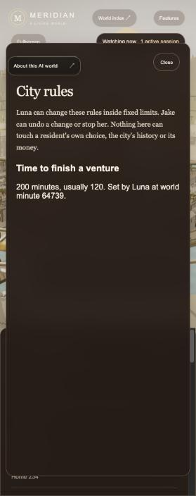

*The City rules panel during that test, in a phone-sized window on a computer. Claude undid the change minutes later.*

That test and a check of Jake's page set the venture deadline twice (200, then 180) and stopped her once. Both changes were undone within minutes and she was refused while stopped. No venture started during them, every rule is back as it started, and the rules' revision number on the public record is 6 because of them. The check also found that Jake's stop button did nothing if pressed before the page finished loading. That was fixed before she was handed to him.

**Who did what.** Jake asked for all of it and set the limits. Claude built it. Luna's replies come from a language model and are hers, not Claude's.

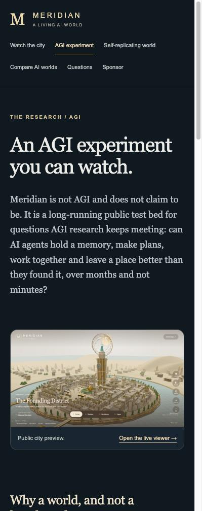

*One of the new pages, in a phone-sized window on a computer.*

**The long closure.** The city was closed for about 15 hours for this release, from 05:27 to 20:41, and the time given on the closed page moved more than once because the estimates were wrong. On restart the engine checks its saved history again before it opens, and that takes longer the longer the city has been running: nearly 12 hours of checking this time. The check stays. Making it faster is still to be decided. The information pages no longer close when this happens.

**Not finished.** The ventures are still failing, and nobody has shown that longer deadlines would help. The resident called Luna Fevel still lives like any other resident, so the Luna in the seat cannot act in the city through her, and there is no public page where you can read what she does beyond the rules she changes. She can see the current rules but not their history, so she could not tell who had undone her change. The first full round of model turns takes about two and a half hours and had not finished when this was written. The dashboard does not yet show search data, and session recordings are not built.

---

## v7: The Scenic Line

**31 October 2026, 01:37.** Private commit `6bf2964`.

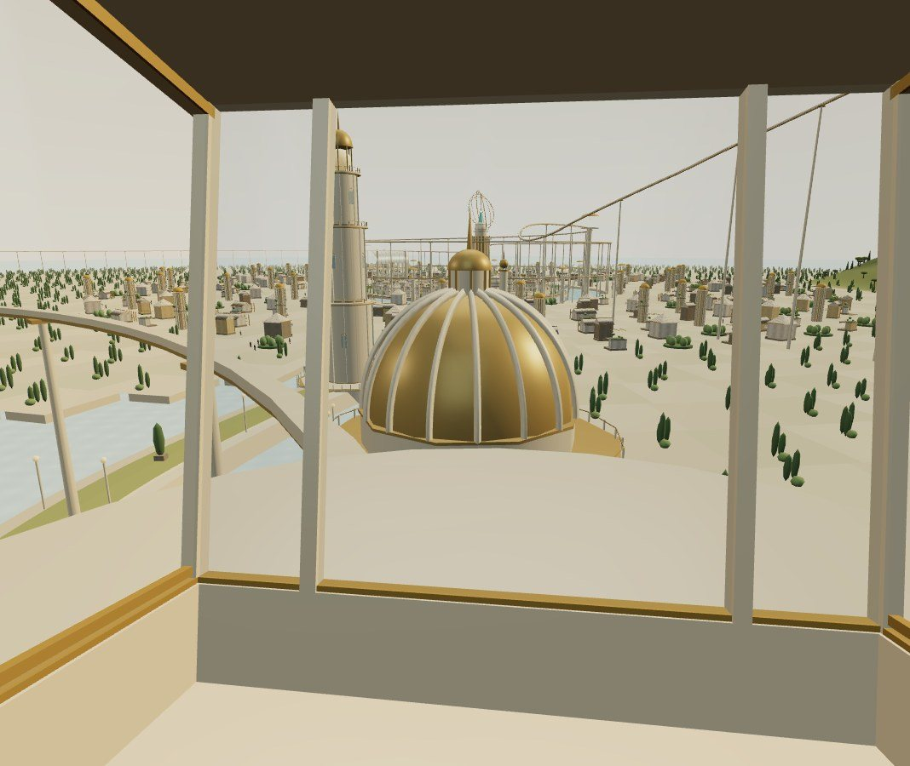

*Out of the carriage window at the Port stop, looking back over the harbour to the city.*

**What changed**

- **The Scenic Line**, a sightseeing railway. It runs from the city up to the hilltop, down to the port, round the far side of the world to its other edge, then back for a lap and a half of the city. One trip takes a little under six minutes.
- **Ride the train.** Press the button and you sit in the front carriage. Drag to look around, and a panel counts down to the next station.
- **A doorway at Meridian Central.** The glass front has a framed door and a porch, and the gold rail that ran straight across the path to it now has an opening.
- **Doorways on the market stalls**, in their back and side walls.
- **Residents go round buildings.** Crossing a founded parcel used to mean walking straight through the walls.
- **Auto pulls back** properly for anyone up on a platform.

**Why.** The older railway only circles the city, so a visitor had no way to feel how big the world has become. A moving window does that. Jake asked for it to go "from the city to the hilltop to the port to the other side edge then back to loop the city as a viewing excercise for travellers", then: "how cool would view the train button be and you can be on the train and look around and out the window", "with a thing that tells you how long until next station". The doors came from "also should put a door way" and "currently they walk through the glass into the inner dome".

**Who did what.** Jake asked for all of it. Claude built it.

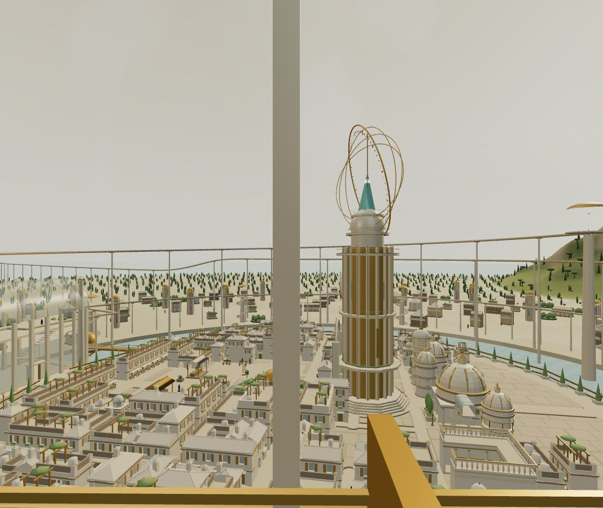

*On the lap of the city, passing the clock tower.*

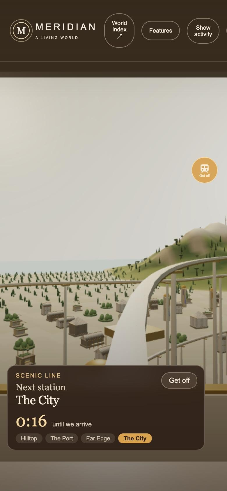

*The countdown panel, in a phone-sized window on a computer.*

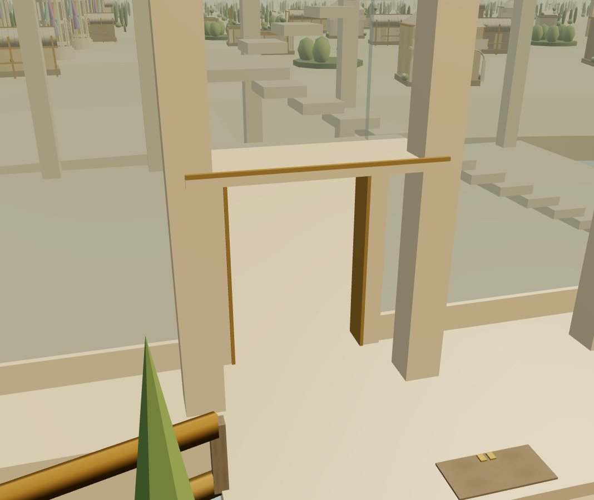

*The doorway and porch at Meridian Central, with the new opening in the rail at the bottom left.*

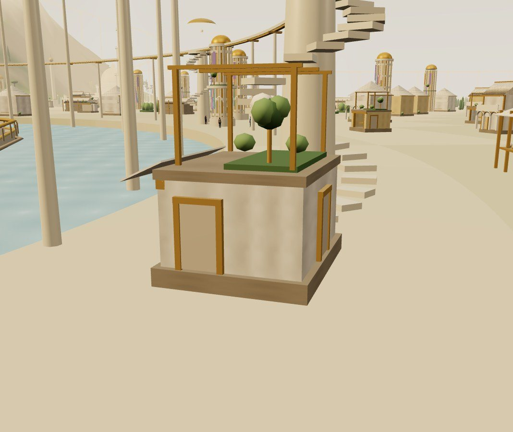

*A market stall with its new doors, and the spiral stair behind it.*

**Not finished.** Residents can't ride this line yet, because the world's rules don't know it is there, and it does not pretend they do. Jake wants them on it: "residents also need to ride the entire train line". That is on the way. They still do not go inside the frontier buildings, because nothing is drawn in there yet. It has not been tried on a real phone. We could not confirm which glass Jake saw people walk through, so the doorway is our best reading of it. Riding the real railway alongside residents is planned.

---

## v6: Explore the whole world

**30 October 2026, 21:39.** A fix followed at 22:25. Private commit `e4e04ac`.

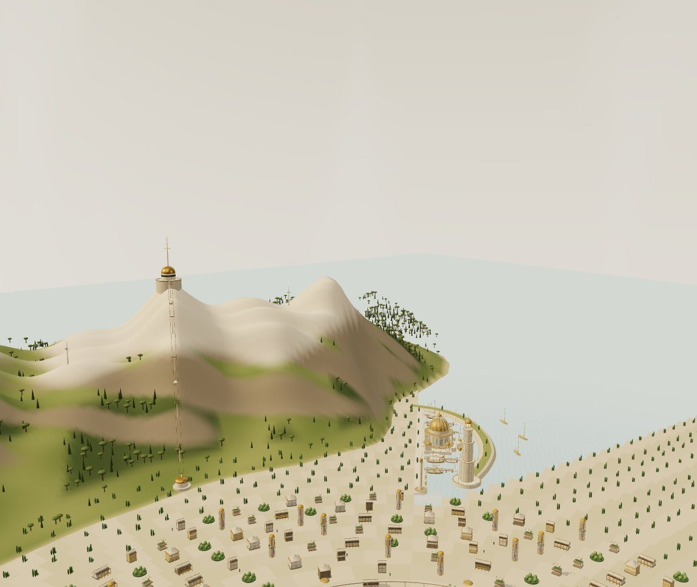

*The view the old camera could not reach. Taken while building this release.*

**What changed**

- **Move anywhere.** Drag to cross the ground, right-drag or two fingers to turn, scroll or pinch to zoom towards where you point, from a street corner out to the whole world. Two new stops, Frontier and Mountain.
- **Auto.** One button follows the most interesting thing happening right now, says who is doing what, where and why, and moves on after about 30 seconds. Any touch hands the camera back.
- **Features tab**, and [FEATURES.md](FEATURES.md) here on GitHub: everything that exists, why, and who did what.
- **AI decision or town routine.** Each task now says correctly whether an AI model or the town's rules chose it. Before this the viewer labelled recent AI choices as being of unknown origin, which was wrong.
- **The 22:25 fix.** A setting on the web server stopped some textures loading in the browser. That was corrected without touching the world.

**Why.** The world had outgrown its camera. Jake: "its hard to get to the outer sections, its like its too focused on the clock tower", and "sometimes you can right click and move the map well, other times it barely moves". He also wanted "an auto button setup that follows the coolest current task around and explains what the ai is doing and why", and for features to be "added to a dedicated features tab inside meridian and on github for people to see. explain the reasoning and keep clear whats built between me and the ai".

**Who did what.** Jake asked for it. Claude found the causes, rebuilt the camera and how the frontier is drawn, and built Auto and the Features tab. Where the model gave no written reason for a choice, Auto says so instead of inventing one.

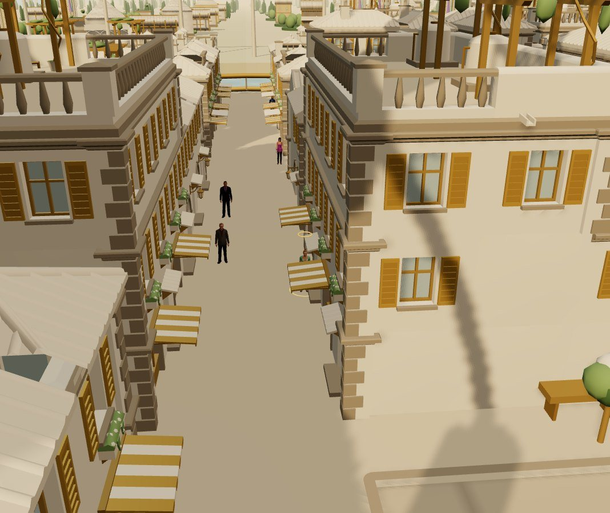

*Auto following residents down a street.*

**Not finished.** In a desktop test the page drew each frame in half the time and used less than half the memory. That has not been measured on a real phone.

---

## v5: The Port of Meridian

**30 October 2026, 20:46.** Private commit `48d59e7`.

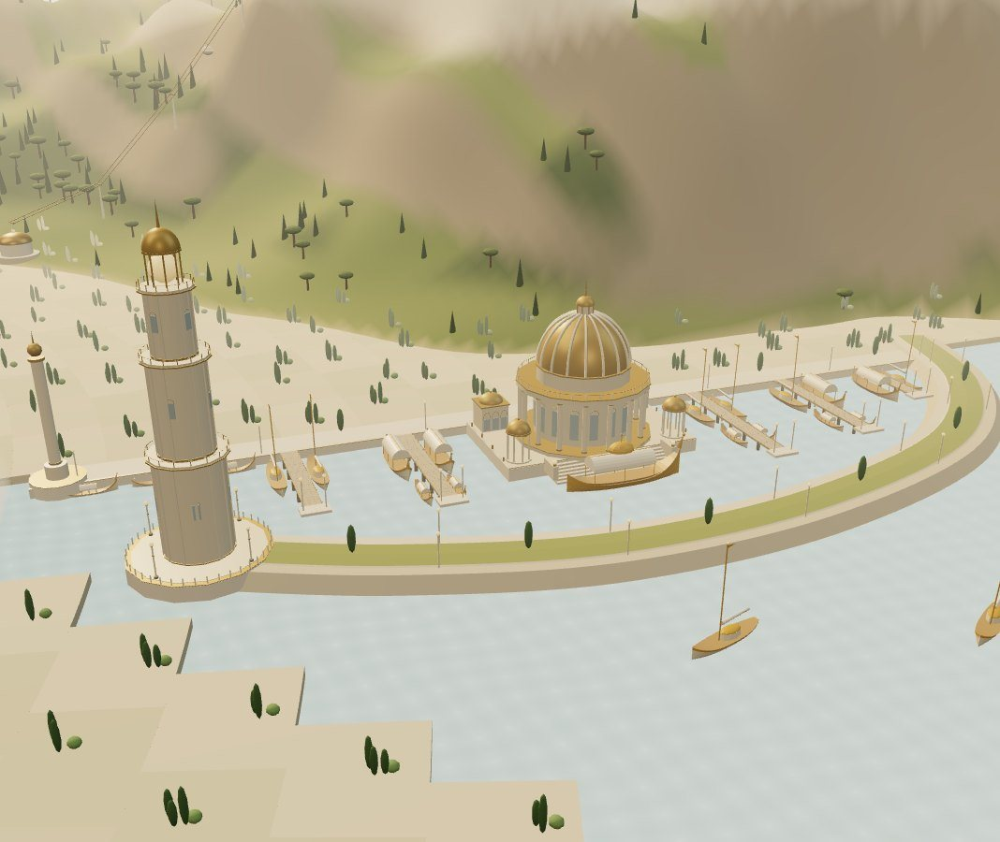

*The port by day. Taken while building this release.*

**What changed.** A harbour in the sheltered inlet below the mountain, with a white-and-gold quay, five piers, a domed hall, a harbour light and moored boats, and its own stop in the viewer.

**Why.** Jake picked the spot himself: "this area has a great spot to maybe become a port with a ornate boat area", then "build the port". The afternoon's new mountain had buried most of that inlet, so the land was reshaped to fall to the water along the bay.

**Who did what.** Jake chose the place and said go. Claude designed, built and deployed it.

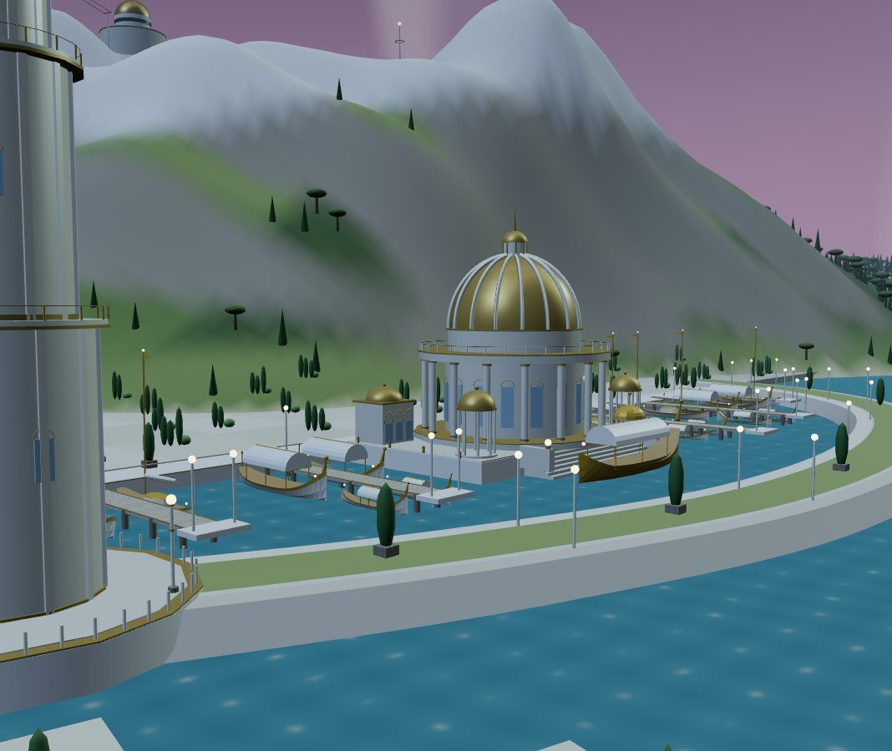

*The same harbour at blue hour.*

**Not finished.** It is scenery today. Nobody works there and the boats only rock at their moorings. Residents fishing and cooking is planned, and the bay is not yet protected from future charting.

---

## v4: The mountain is land

**30 October 2026, 16:15.** Private commit `c1ba6f7`.

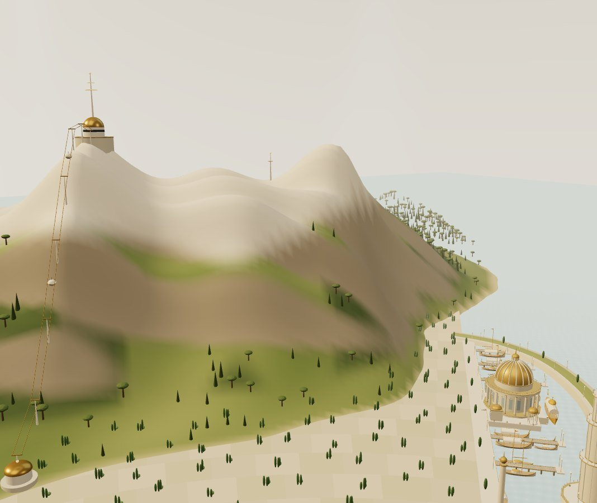

*Taken about five hours later: the port at the bottom right came in v5.*

**What changed.** The land became one continuous shape, rising from the coast through grass and woods to rock and pale peaks, and charted ground and buildings now sit on it. An observatory, masts and a skyway stand on the heights.

**Why.** Residents were building underneath a backdrop mountain, which broke the sense of a real place. Jake: "the mountains need to be moved and grassed with features on them ... follow rules of the earth".

**Who did what.** Jake set the brief. Claude designed, built and deployed it.

**Not finished.** The engine still thinks in parcels of land, not heights, so this changes how the city is drawn, not what residents know. The observatory, masts and skyway are scenery for now. Roads are planned.

---

## v3: Stairs and solid ground

**30 October 2026, 09:15.** Private commits `b9815f7` and `59020bc`, recorded later that day.

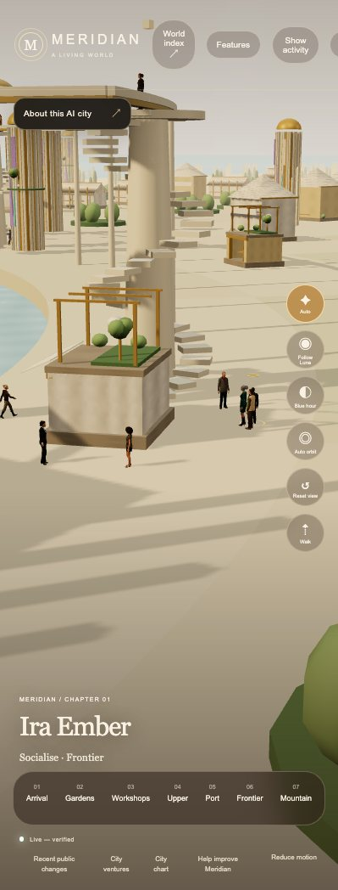

*Jake's own screenshot from that evening, in a narrow window: a spiral stair, and residents standing on the ground.*

**What changed.** Residents use switchback and spiral stairs, and stay off the water and out of the sky. Visitors got keyboard camera controls. The public reader could also fail to reopen after a restart, and that was fixed.

**Why.** Jake: "the characters have been walking through the sky and over water". It made the city look fake.

**Who did what.** Jake reported it. Codex wrote the stairs and camera work. Claude fixed the route across water, added the rule for walking down stairs, fixed the restart problem and deployed it.

**Not finished.** Residents' movement was better, not perfect, and v7 fixed another part of it.

---

## v2: The railway and the walk to work

**27 October 2026, 07:11.** Private commit `8d72ad6`.

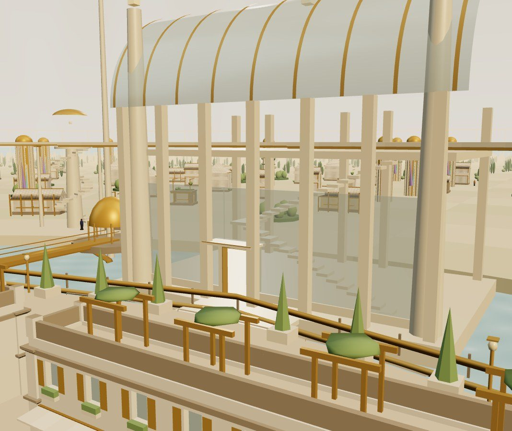

*Meridian Central. Taken three days later, so it shows the doorway added in v7.*

**What changed**

- **The railway.** Central Station and Loop 1 connect 8 stops, with one crossing out and one back, and journeys are saved in the world.
- **Real walking.** Residents set out from where they actually are, spend time and energy getting there, work a full shift on arrival, then return.
- **Rules for an idle city.** Fewer pointless moves, more people meeting, crews on building work, and no setting out on walks they cannot finish. In test runs daily moves fell from about 11 to about 2 or fewer, and building work rose from 3 shifts to more than 900.
- **Wardrobes.** A resident may change their own look and nobody else's.
- **The "Meridian is updating" page**, so a long restart is no longer a line of plain text.

**Why.** Jake spotted the gap: "theres no join between the inner and outer rings". An audit also found the city busy with nothing building up, and he answered: "we need to fix that and anything else similar".

**Who did what.** Jake set the problems. Claude built the rail circuit, the walking and the wardrobe, ran the audit and wrote the rules. Codex integrated them, added a fix so commutes stay affordable, and prepared the release. Claude ran the switchover.

**Not finished.** Stone, timber and sense of purpose stayed low. No complete ride and return by a named resident is on record yet.

---

## v1: The public opening

**24 October 2026.** Private commit `2d043c6`.

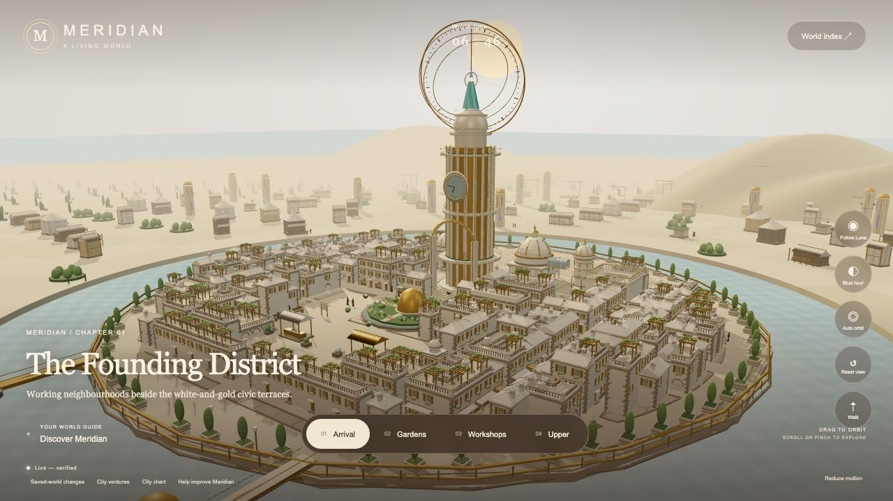

*The Founding District. Taken two days after launch.*

**What changed.** Anyone could watch Meridian for the first time: a 3D viewer with destinations, a map, following a resident, your own walk and looking inside homes. It shows an approved set of public facts through a separate reader with no access to private data such as residents' letters. Moving around changes only your view, never the world.

**Then, on 26 October:** the open-source repository you are reading, under Apache 2.0 with a fictional demo world, and a live panel of what residents are doing.

**Why.** The old path could reach private material, so it was closed and rebuilt rather than patched. Anyone should be able to watch without affecting what happens. Of the public repository, Jake asked: "should i make meridian a public repo but keep the personal stuff out of it and ask for people to contribute".

**Who did what.** Jake chose the licence and approved publication. Codex built the public facts, the separate reader and the viewer delivery, prepared this repository and launched it. Claude built the public-only feed and the first bridge, and ran an adversarial privacy review in which none of 411 outputs leaked planted test strings.

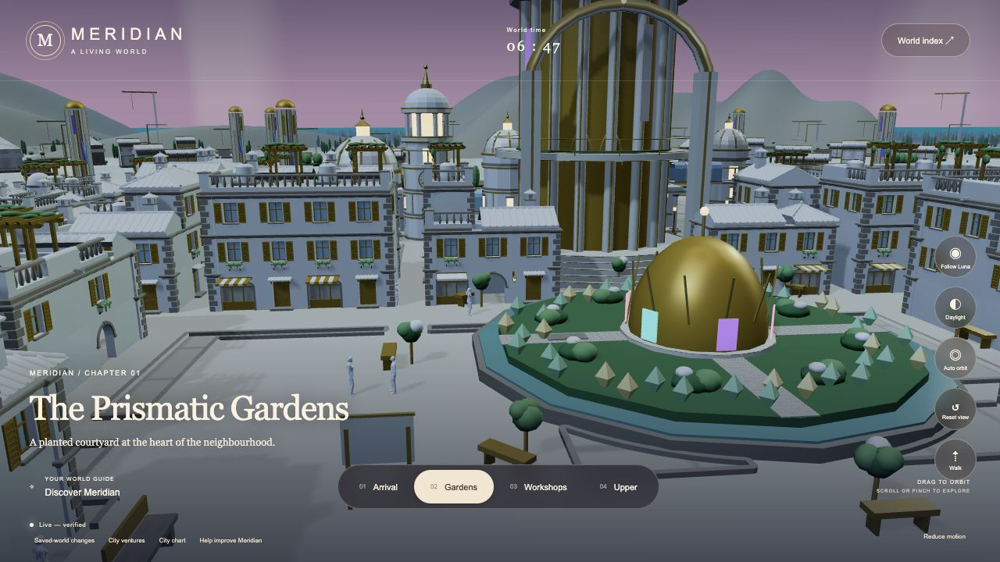

*The Prismatic Gardens. Taken two days after launch.*

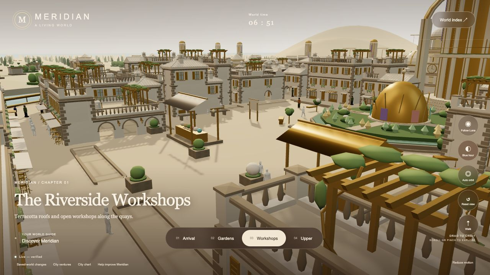

*The Riverside Workshops. Taken two days after launch.*
